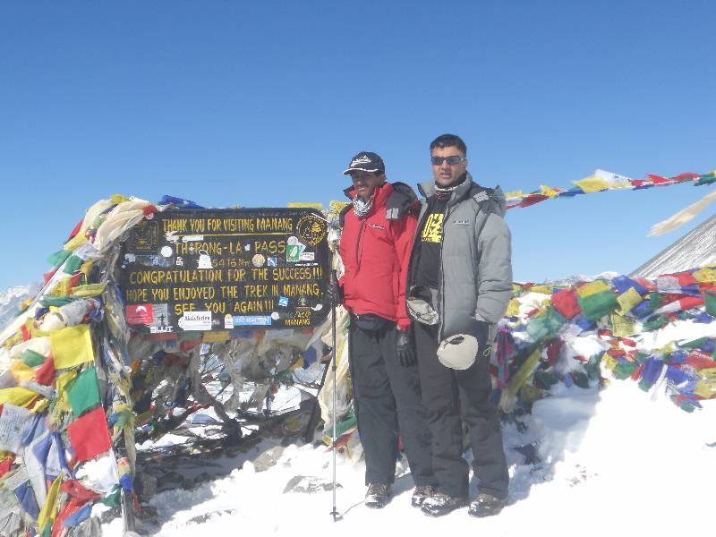
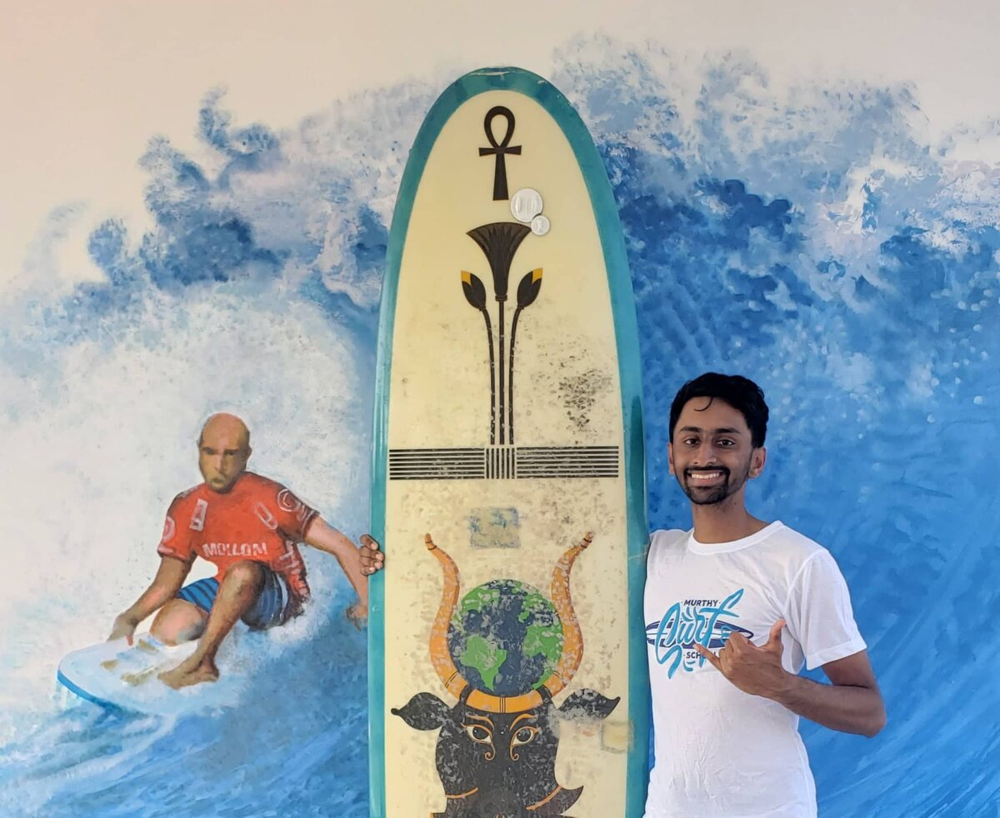

### Running
I competed in a range of atheletics events, particualarly long distance running (5Ks and 10Ks).
I have been running sub-50 min 10Ks since the age of 15.

### Trekking
High-altitude trekking is the perfect mix of exercise and amazing views! My most notable
hike has been the Annapurna Circuit (120 km, 11 days), peaking at a height of 5400m at the
age of 14.

### Badminton
Badminton has been my primary sport of interest, and I have competed frequently in university,
and state championships back in India.

### Surfing
A more recent endaevor since 2020, I have enjoyed surfing across the globe in various countries.

