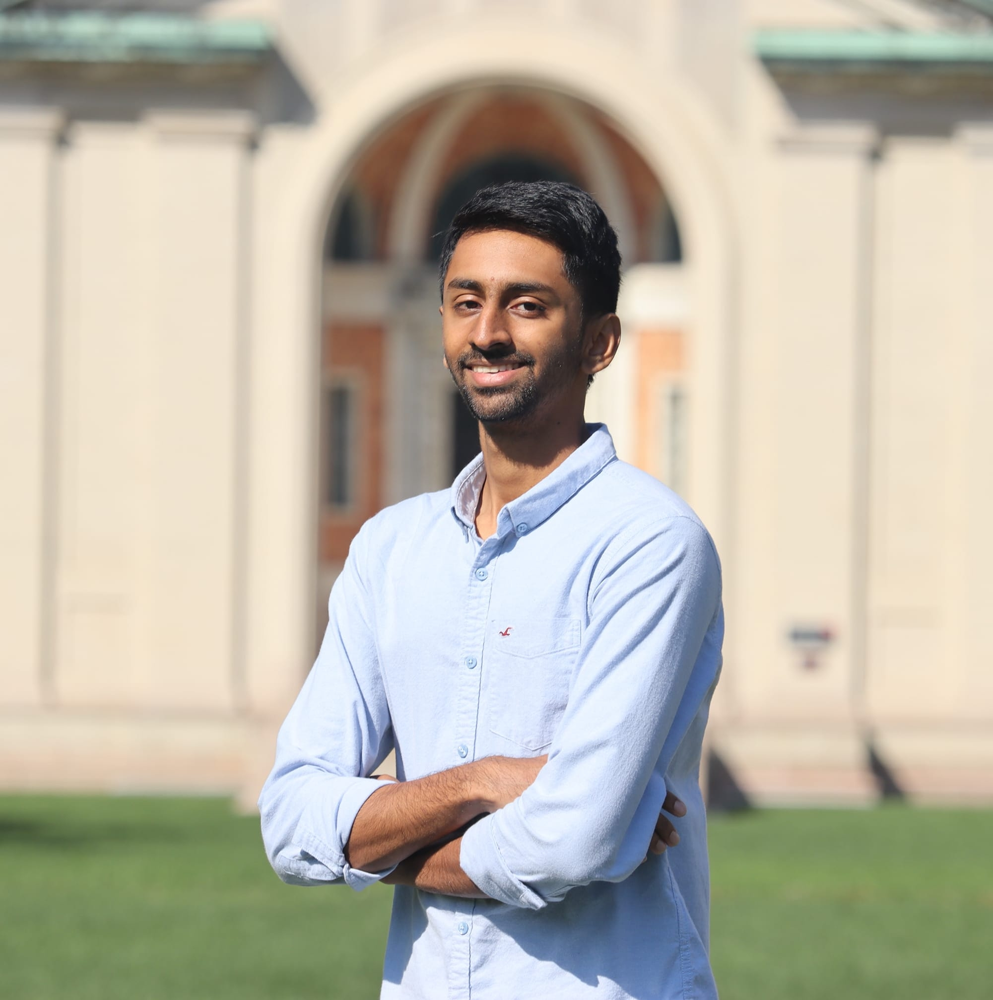

## Biography
{ align=left width=30% style=margin:1em;margin-left:0;margin-top:0.3em;margin-bottom:0.3em }

A hacker who likes low-level systems works, with cross-cutting interests across virtualization,
  operating systems, compilers, and architecture.

I currently work at [*Vectorware*](https://www.vectorware.com/), a startup trying to break the shackles
of the GPU programmability stack.
I graduated with a PhD from *CMU*, advised by [Anthony Rowe](https://users.ece.cmu.edu/~agr/) and [Ben Titzer](https://s3d.cmu.edu/people/core-faculty/titzer-ben.html),
where I investigated harnessing *Wasm* to unlock safety and observability
in resource-constrained edge systems.
I have also designed a [custom out-of-order RISC-V CPU](projects.md/#extending-the-risc-v-isa), 
an [FPGA](projects.md/#xc2064-fpga-design), and participated in numerous hackathons-style events.

A common theme in my life seems to be climbing things. Whether it's on two wheels or two feets,
  cycling or bouldering endeavours are limitless: I'm always looking for the next big hill!
With a passion for travelling, I live spontaneously and enjoy embracing elements from many cultures, including my Indian and American roots.

<!---
A notably exciting one was a fully-functional in-house out-of-order RISC-V core with custom perfomance-enhancing extensions to 
the ISA. A more detailed list of my personal projects can be found [here](projects.md)
--->

 
## News

* *Sep 2026*: :material-briefcase-plus-outline: Started a full-time role as a Software Engineer at [*Vectorware*](https://www.vectorware.com/).
* *Jul 2026*: :fontawesome-solid-user-graduate: Defending my PhD Dissertation on *Unlocking Safety and Observability for Edge Cyber-Physical Systems with Low-Level Bytecode Virtualization*!
* *Feb 2026*: :material-newspaper: LLVM-22 release introduces a target for WALI! (*wasm32-linux-muslwali*) 
* *Sep 2025*: :octicons-milestone-24: Completed my Thesis Prospectus!
* *Aug 2025*: :material-podcast: Tune in to this [**WebAssembly Unleashed episode**](https://www.youtube.com/watch?v=OhybI5aUy5M) where I discuss excitement around debugging with Wasm.
* *Mar 2025*: :material-briefcase-plus-outline: Starting an internship at *F5 Networks Inc.* for the Summer '25.
* *Feb 2025*: :material-file-document-check: Paper Accepted -- *Interference-Aware Edge Runtime Prediction with Conformal Matrix Completion* at *MLSys '25*! 
* *Feb 2025*: :material-file-document-check: Paper Accepted -- *Unveiling Heisenbugs with Diversified Execution* at *OOPSLA '25*! :fontawesome-solid-bug:
* *Feb 2025*: :material-microphone-variant: Invited talk -- *Towards Holistic Observability of Edge CPS* at Wasm Research Day
* *Jan 2025*: :material-file-document-check: Paper Accepted -- *Empowering WebAssembly with Thin-Kernel Interfaces* at *EuroSys '25*! :simple-webassembly: :simple-linux:
* *Jan 2025*: :material-file-document-check: Paper Accepted -- *Silverline* (collaboration with Bosch Research) at *RTAS '25*! :simple-webassembly:
* *Oct 2024*: :material-microphone-variant: Invited talk -- *Unveiling CPS Heisenbugs at Scale* at Bosch RDS Tech Colloquium
* *Jun 2024*: :material-microphone-variant: Invited talk -- *Leveraging Wasm as a Debugging Target* at Wasm Research Day
* *Oct 2023*: :material-microphone-variant: Invited talk -- *Leveraging Wasm Instrumentation* at Wasm Research Day (with Tianshu Huang)
* *Apr 2023*: :fontawesome-solid-user-graduate: Officially a PhD Candidate after passing my qualifiers
* *Oct 2022*: :material-microphone-variant: Invited talk -- *Giving the Cloud an Edge with WebAssembly* at Wasm Research Day (with Tianshu Huang)
* *Jun 2022*: :material-briefcase-plus-outline: Edge IoT Internship at Bosch Research begins for the Summer of '22!
* *Aug 2021*: :material-briefcase-plus-outline: Started my PhD at Carnegie Mellon University!
* *May 2021*: :fontawesome-solid-user-graduate: Graduated with a Bachelors degree from UT Austin :metal: 

 
## Contact

*:material-office-building-marker: Work Address* 
> CIC **2313E** (2nd floor)
 
> 4720 Forbes Avenue, Pittsburgh, PA 15213

:material-gmail:&nbsp; [arjunr2@andrew.cmu.edu](mailto:arjunr2@andrew.cmu.edu)

 
